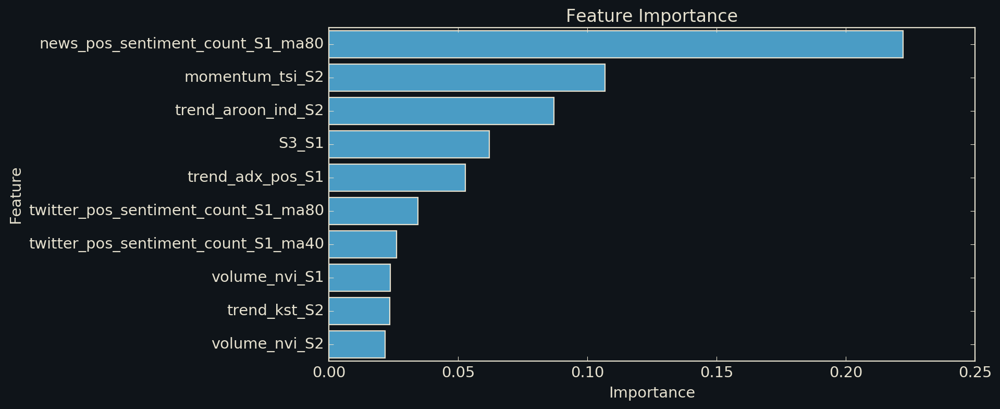
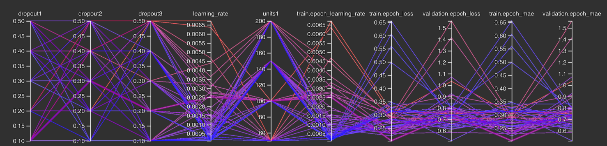
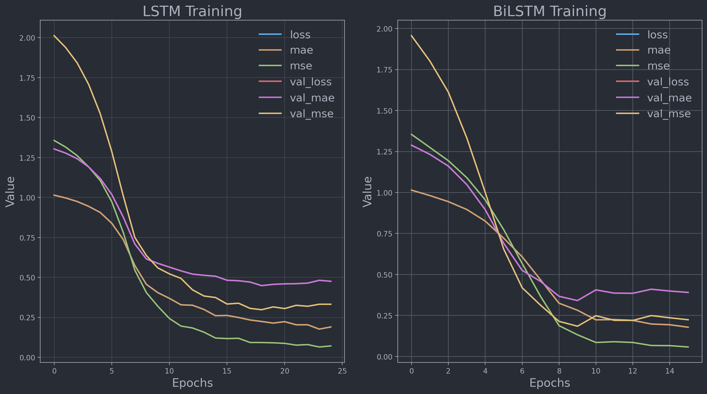
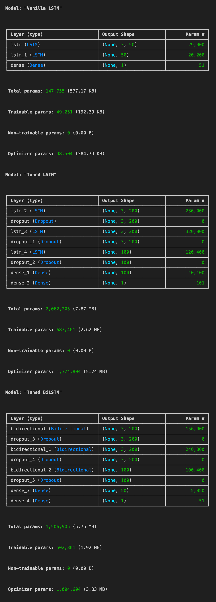

# Assessing the Impact of ML Model Architecture Complexity on Pairs Trading Optimization

Darien Nouri, Charles Wang and Yihao Zhong. New York University, 2024.


## Introduction

This project investigates the relationship between machine learning model complexity and the effectiveness of pairs trading strategies. Pairs trading is a mean-reversion strategy that seeks to profit from the relative price movements of two correlated securities. The core idea is to identify pairs of securities that historically move together, then take long and short positions when their prices diverge, anticipating a return to their historical relationship. We explore how increasing model sophistication affects performance in predicting the spread between stock pairs.

<p style="font-size:14px">
<b>Note:</b> <i>Actually implementing a viable pairs trading strategy is not the main focus of this project. The main focus is to evaluate performance as a function of varying model complexity in forecasting the spread between two stocks. The pairs trading strategy is just a simple example of how the forecasted spread can be used in practice. The models are research artifacts and are not intended for live trading.</i>
</p>


## Procedure

Our approach involves:

1. **Stock Pair Selection**: We developed a systematic approach to identify stock pairs from the S&P universe based on correlation and cointegration criteria.
2. **Data Collection and Preprocessing**: We gathered extensive data from various sources, including technical indicators and sentiment data from Refinitiv, financial news headlines, and Twitter.
3. **Feature Engineering**: Derived 274 to 280 features per pair from both stocks and their spread, incorporating technical indicators as well as sentiment analysis to capture potential market shifts not yet reflected in price data.
4. **Model Development**: Implemented and compared various models in forecasting spread, including:

   - Traditional regression models (Linear Regression, Gradient Boosting, Random Forest, LightGBM)
   - Deep learning models (Vanilla LSTM, Hyperparameter-tuned LSTM, BiLSTM)
5. **Hyperparameter Tuning**: Implementation of Keras Tuner to optimize model architectures and hyperparameters.
6. **Model Evaluation**: Models were trained and evaluated using standard metrics such as MSE, MAE, and R2.
7. **Backtesting**: Implemented a simple mean reversion strategy to backtest the models' performance in a simulated trading environment.


## Stock Pair Selection

We developed a systematic approach to identify stock pairs from the S&P, focusing on statistical relationships rather than potential profitability. Every model was run on the same set of pairs.
Pairs were ranked on two criteria:

- Cointegration: Minimized p-value to indicate stronger long-term equilibrium.
- Correlation: ranked from highest to lowest. The final rank (agg_rank) sorts pairs by the sum of the two ranks.

We chose the S&P universe to ensure stocks likely to have meaningful news coverage. The top 10 ranked pairs based on our criteria are:

| agg_rank | ticker_0 | ticker_1 | corr   | cointeg_pval |
| -------- | -------- | -------- | ------ | ------------ |
| 0        | GS       | BLK      | 0.8344 | 0.016        |
| 1        | JPM      | CRM      | 0.839  | 0.0265       |
| ...      |          |          |        |              |
| 9        | HON      | C        | 0.7518 | 0.2875       |
| 10       | C        | BLK      | 0.7826 | 0.3438       |

Not every listed pair is cointegrated at the 5% level (ranks 9 and 10 have p = 0.2875 and 0.3438). The ranking used prices from 2021-01-01 to 2024-03-01, which overlaps the models' test periods.


### Feature Engineering and Importance

We developed our feature set with the goal of capturing bespoke patterns and influences that could potentially influence the spread between the stock pairs.

Each pair has 274 to 280 features, in these groups:

1. [Historical Pricing data](miscellaneous/data_preprocessing/save_price_hist_indicators_tofile.ipynb) (e.g., price, volume, volatility)
2. [Derived Technical-Indicators](data_utils/technical_indicators.py) (e.g., moving averages, oscillators, volatility measures) 
3. [Stock sentiment indicators](sentiment_analysis/NexiSentiment.ipynb)
4. Spread-derived pricing and sentiment features between pairs

5. Temporal features capturing seasonal and cyclical patterns




The top-ranked feature is `news_pos_sentiment_count_S1_ma80`, an 80-day moving average of positive news mentions for the first stock in the pair, at about twice the importance of the next feature.


- Relevant Code: 
  - [Feature set construction](miscellaneous/data_preprocessing/join_technicals_with_sentiments.ipynb)
  - [technical_indicators.py](data_utils/technical_indicators.py)
  - [analysis_setup.ipynb](models/supporting/analysis_setup.ipynb)

## Model Training and Evaluation


Relevant code: [analysis_lstm_hypertuned_all_forecasts.ipynb](models/analysis_lstm_hypertuned_all_forecasts.ipynb).

### Regression Models

Established a baseline using traditional regression models:

- Linear Regression
- Gradient Boosting Regression
- Random Forest Regression
- LightGBM Regression

### Deep Learning Models

- Vanilla LSTM: Two LSTM layers (50 units each) with a dense output layer
- Hyperparameter-tuned LSTM: Optimized using Keras Tuner
- BiLSTM with Dropout

### Hyperparameter Tuning

Used [KerasTuner with RandomSearch](https://www.tensorflow.org/tutorials/keras/keras_tuner)

- Number of LSTM layers (1-3)
- Units per layer (50-200)
- Dropout rates (0.1-0.5)
- Dense layers (1-2)
- Learning rate [1e-2, 1e-3, 1e-4]

The tuning process ran for 100 trials, with early stopping after 4 epochs without improvement to limit overfitting.



### Model Complexity

The Vanilla LSTM had 49,251 parameters, while the tuned LSTM model reached up to 2,062,205 parameters.

### Evaluation

Models were trained and evaluated using MSE, MAE, and R2 metrics. Training curves and architecture visualizations were generated to compare model performance.





This approach allowed us to investigate the relationship between model complexity and forecasting performance in the context of pairs trading.

### Model Performance

Test-set forecast error for one pair, GOOGL/BLK, the last pair processed in [backtester.ipynb](backtesting/backtester.ipynb). The tree models were scored from 2022-05-17 and the LSTMs from 2022-08-23, both through 2023-12-26.

| Model                     |      R2 |    MAE |    MSE |   RMSE |
| ------------------------- | ------: | -----: | -----: | -----: |
| GradientBoostingRegressor |  0.6582 | 0.5729 | 0.5203 | 0.7213 |
| RandomForestRegressor     |  0.6885 | 0.5479 | 0.4743 | 0.6887 |
| LGBMRegressor             |  0.6634 | 0.5547 | 0.5124 | 0.7158 |
| Vanilla LSTM              | -0.1247 | 1.1471 | 1.7872 | 1.3369 |
| LSTM                      |  0.4565 | 0.8177 | 0.8636 | 0.9293 |
| BiLSTM with Dropout       |  0.4087 | 0.8358 | 0.9396 | 0.9694 |

Linear regression is not shown: its forecast diverged on this pair (test R2 about -2e21). Forecasts and metrics for all 18 pairs are saved in [model_predictions_all_pairs.pkl](data/model_results/model_predictions_all_pairs.pkl).

## Backtesting

### Methodology

For backtesting the trained models, we implemented a simple mean reversion strategy here [backtester.ipynb](backtesting/backtester.ipynb).

1. **Calculate Trading Signals**: The trading signals (long or short) are based on the predicted z-scored spread, previously calculated [here](models/analysis_lstm_hypertuned_all_forecasts.ipynb), and a predefined threshold. If the predicted z-scored spread was below the threshold, we generated a long signal, and if it was above, we generated a short signal.
2. **Backtest Strategy Execution**: We implemented a mean reversion strategy based on the generated trading signals. The strategy involved taking long or short positions in the stock pairs when the predicted spread deviated from its historical relationship (as determined by the z-scored spread threshold). The hedge ratio between the two stocks is re-estimated each day with a BayesianRidge regression on earlier prices only, and the z-score signal threshold is fixed.
3. **Per-pair runs**: Each of the 18 pairs was backtested separately.

[`backtester.ipynb`](backtesting/backtester.ipynb) contains the course backtest. It has known implementation issues (transaction costs were not applied and P&L is computed from position value rather than price changes), so its figures are not reported here.

## Analysis and Insights

1. **Forecast error vs. complexity**: On GOOGL/BLK all three tree models had lower test MSE than all three LSTMs. Across the 18 pairs the pattern was not consistent: the best tree model had lower test MSE than the best LSTM on 8 of the 18 pairs.
2. **Sentiment features**: A sentiment feature ranked first in feature importance (see above). No ablation was run, so how much the sentiment features helped each model is untested.

<hr>

## Future Work

### Model Architecture and Techniques

1. **Time Series Transformers**: Explore specialized transformers for financial time series data such as the one found [here](https://huggingface.co/docs/transformers/en/model_doc/time_series_transformer).
2. **Alternative Architectures**: Investigate TCNs, hybrid models, and Graph Neural Networks.
3. **Ensemble Methods**: Combine predictions from multiple models of varying complexity.
4. **Reinforcement Learning**: Implement for dynamic portfolio optimization.
5. **Activation Analysis**: Investigate activation patterns within complex models to identify influential feature combinations for spread forecasting.


### Model Optimization and Robustness

5. **Custom Optimization or Loss Functions**: Develop custom optimization or loss functions tailored to the specific trading objective to further improve performance.
6. **Deeper Hyperparameter Search**: Conduct more extensive tuning using advanced techniques like Bayesian optimization.
7. **Robustness to Unexpected Events**: Stress test models under simulated extreme market conditions.
8. **Extended Market Conditions**: Analyze performance across various market cycles.

### Data Integration and Feature Engineering

8. **Fundamental Data Integration**: Explore the potential of incorporating fundamental data, such as financial statements, earnings reports, and economic indicators.
9. **Street Expectations**: Incorporate analyst forecasts and market expectations into the model inputs.
10. **Sector and Name-Focused KPIs**: Integrate industry-specific and company-specific key performance indicators to enhance prediction accuracy.


<br>

<hr>


### Directory Structure

Key Notebooks:
- [`LSTM Tuning and Batch Runner`](models/analysis_lstm_hypertuned_all_forecasts.ipynb): Notebook for hyperparameter tuning of LSTM models and evaluating performance across all pairs.
- [`Backtester`](backtesting/backtester.ipynb): Implementation of backtesting strategy.
- [`Feature Construction`](miscellaneous/data_preprocessing/join_technicals_with_sentiments.ipynb): Feature set construction/dataset merging.
- [`Price Data Processing`](miscellaneous/data_preprocessing/save_price_hist_indicators_tofile.ipynb): Historical pricing data processing.
- [`Sentiment Analysis`](sentiment_analysis/NexiSentiment.ipynb): Bert transformer based sentiment analysis processing.
- [`News Headline Collection`](sentiment_analysis/async_news_scraper.py): Headline collection from Nexis Uni through NYU library access (session supplied by the user).

Project Structure:
```
.
├── backtesting                          # Scripts for backtesting trained models
├── data                                 # Various datasets used in the project
│   ├── nexis_news_data_cleaned          # Cleaned news data from Nexis
│   ├── price_history                    # Historical price data for stocks
│   ├── sentiments                       # Sentiment data for stocks
│   └── technical_indicators             # Technical indicators for stocks
├── data_utils                           # Utility library for Refinitiv data
├── docs                                 # Supporting publications
├── figures                              # Visualizations and graphs
├── miscellaneous                        # Utility scripts and preprocessing tools
├── models                               # Training and evaluation notebooks
│   ├── archive                          # Archived model files
│   ├── logs                             # Model training logs
│   └── supporting                       # Supporting scripts and notebooks
└── sentiment_analysis                   # Sentiment analysis and news scraping

```
<br>

> **Note:** Academic course project. Refinitiv and Nexis data were accessed through NYU's licenses and are for academic use only.

<hr>

### References

[1]: [Nouri, D., Wang, C., &amp; Zhong, Y. (2024). *ML Model Complexity and U.S. Securities Strategy*. New York University.](docs/supporting_publications/ML_Model_Complexity_and_US_Securities_Strategy.pdf)

[2]: [Staffini, A. (2022). Stock price forecasting by a deep convolutional generative adversarial network. Frontiers in Artificial Intelligence, 5, 837596. Frontiers](docs/supporting_publications/Fuzzy_AI_Applications_in_Finance.pdf) · [doi:10.3389/frai.2022.837596](https://doi.org/10.3389/frai.2022.837596)

[3]: [Otabek, S., &amp; Choi, J. (2024). Multi-level deep Q-networks for Bitcoin trading strategies. Scientific Reports, 14(1), 771. Nature Portfolio](docs/supporting_publications/Innovative_Methods_in_Financial_Analysis.pdf) · [doi:10.1038/s41598-024-51408-w](https://doi.org/10.1038/s41598-024-51408-w)

[4]: [Rostamian, A., &amp; O’Hara, J. G. (2022). Event prediction within directional change framework using a CNN-LSTM model. Neural Computing and Applications, 34, 17193-17205. Springer](docs/supporting_publications/Hybrid_Approaches_for_Stock_Price_Prediction.pdf) · [doi:10.1007/s00521-022-07687-3](https://doi.org/10.1007/s00521-022-07687-3)

[5]: [Shah, J., Vaidya, D., &amp; Shah, M. (2022). A comprehensive review on multiple hybrid deep learning approaches for stock prediction. Intelligent Systems with Applications, 16, 200111. Elsevier](docs/supporting_publications/Financial_Prediction_Using_Machine_Learning.pdf) · [doi:10.1016/j.iswa.2022.200111](https://doi.org/10.1016/j.iswa.2022.200111)

[6]: Xu, Z., &amp; Luo, C. (2023). Improved pairs trading strategy using two-level reinforcement learning framework. Engineering Applications of Artificial Intelligence, 126, 107148. Elsevier · [doi:10.1016/j.engappai.2023.107148](https://doi.org/10.1016/j.engappai.2023.107148)

[7]: Shin, H.-G., Ra, I., &amp; Choi, Y.-H. (2019). A deep multimodal reinforcement learning system combined with CNN and LSTM for stock trading. In 2019 International Conference on Information and Communication Technology Convergence (ICTC) (pp. 7-11). IEEE · [doi:10.1109/ICTC46691.2019.8939991](https://doi.org/10.1109/ICTC46691.2019.8939991)

[8]: Shah, D., Campbell, W., &amp; Zulkernine, F. H. (2018). A comparative study of LSTM and DNN for stock market forecasting. In 2018 IEEE International Conference on Big Data (Big Data) (pp. 4148-4155). IEEE · [doi:10.1109/BigData.2018.8622462](https://doi.org/10.1109/BigData.2018.8622462)